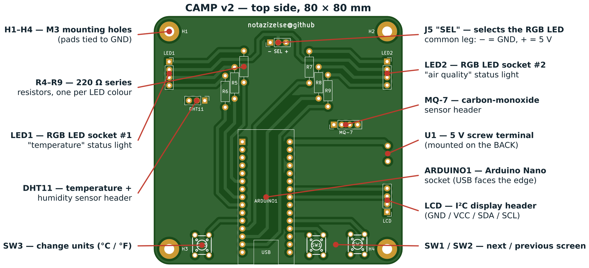
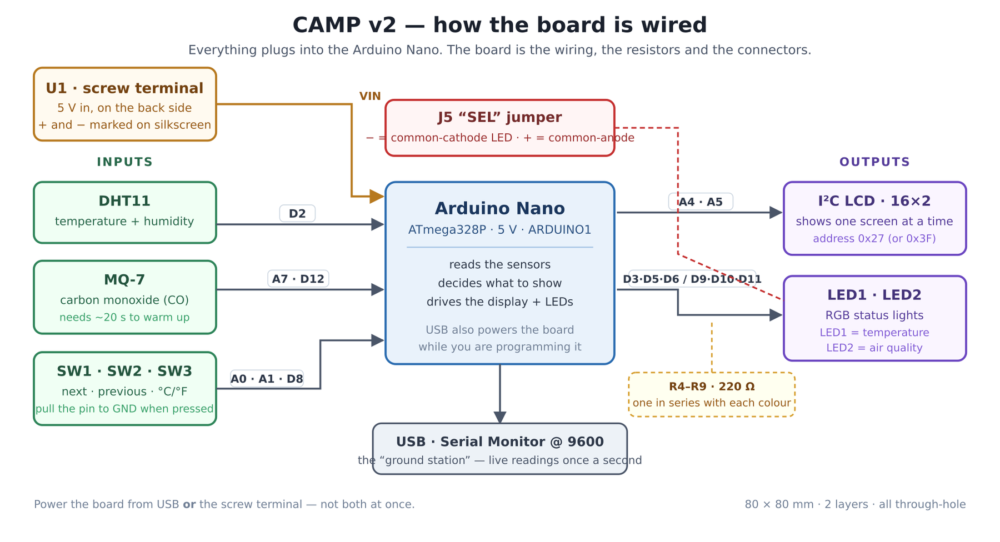
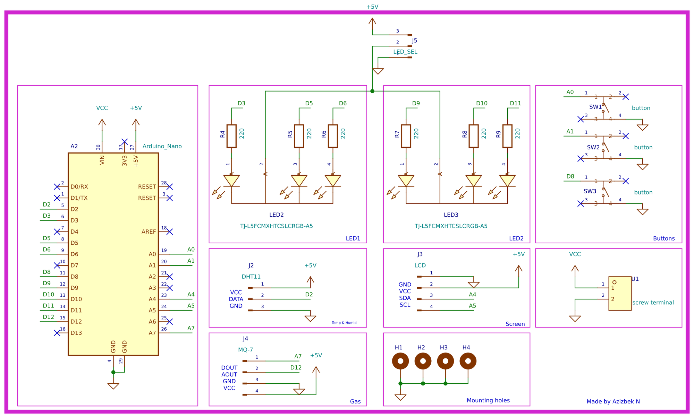
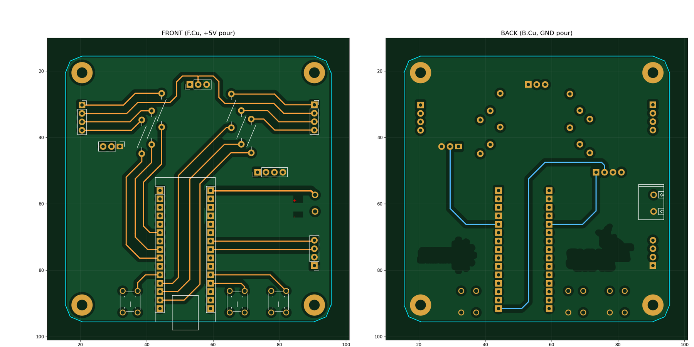
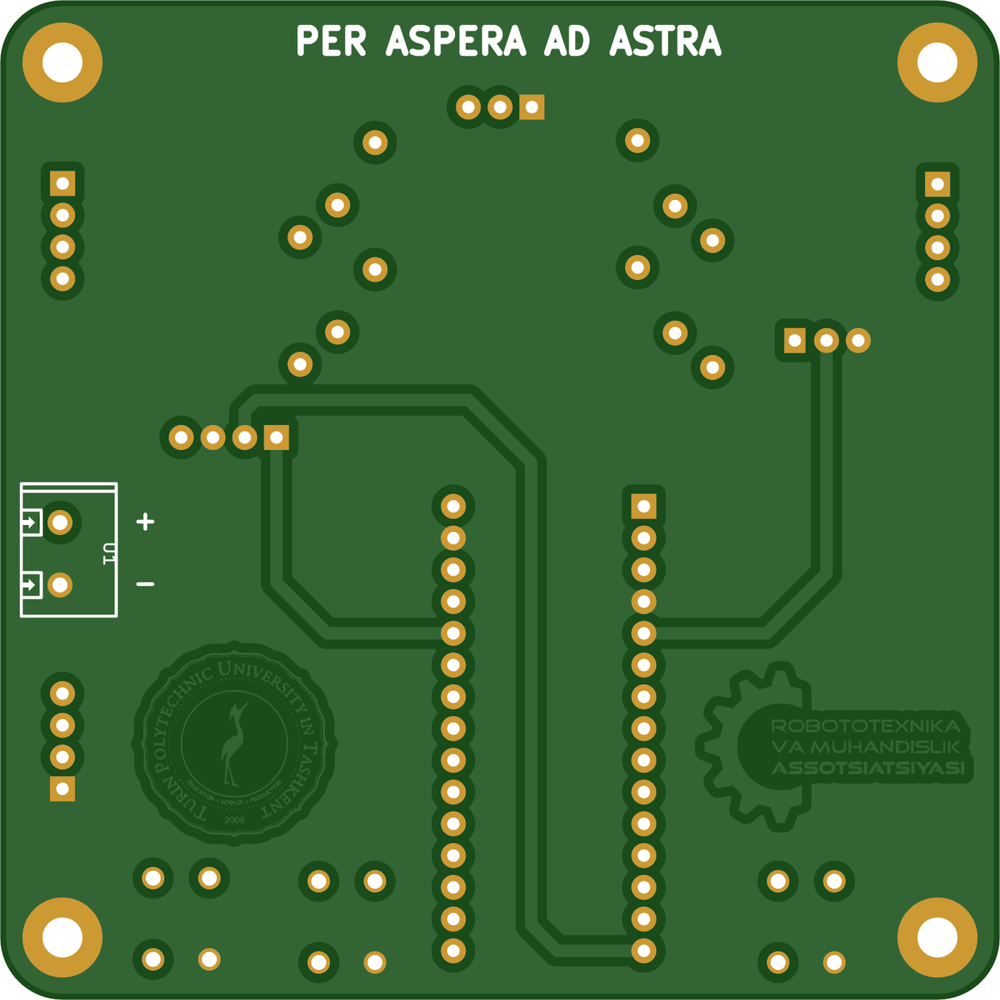

# CAMP v2 — TechnoCamp Sxemotexnika Darsi Platasi

**Bir dam olish kunida yig'sa bo'ladigan CubeSat bort kompyuteri.**

Bu 80 × 80 mm o'lchamli Arduino Nano uchun asos plata. U bir nechta alohida sensor
modulini bitta tartibli asbobga aylantiradi: atrofdagi haroratni, namlikni va uglerod
oksidi (CO) miqdorini o'lchaydi, natijani kichik ekranda ko'rsatadi va USB orqali
kompyuterga uzatadi — xuddi haqiqiy CubeSat'ning bort kompyuteri qiladigan ish.

Barcha detallar teshikli (through-hole) turdagi, shuning uchun uni oddiy kavsharlash
asbobi bilan, lupa ishlatmasdan yig'ish mumkin. Platada o'zining mikrosxemasi yo'q —
barcha hisob-kitobni Arduino Nano bajaradi. Plata beradigan narsa: toza o'tkazgichlar,
kerakli joyda kerakli rezistorlar va faqat bir tomonga kiradigan ulagichlar.

> 🇬🇧 **English version of this document: [README.md](README.md)**
> 🔧 Muhandislar uchun: sxema tugunlari va ishlab chiqarish ma'lumotlari →
> [docs/hardware-reference.md](docs/hardware-reference.md) (inglizcha)



---

## Mundarija

- [Nima kerak bo'ladi](#nima-kerak-boladi)
- [Plata qanday ishlaydi](#plata-qanday-ishlaydi)
- [Prinsipial sxema](#prinsipial-sxema)
- [Yig'ish](#yigish)
- [Dasturni yuklash](#dasturni-yuklash)
- [Ishlatish](#ishlatish)
- [Sinab ko'radigan ishlar](#sinab-koradigan-ishlar)
- [Ishlamasa nima qilish kerak](#ishlamasa-nima-qilish-kerak)
- [Loyihaning tuzilishi](#loyihaning-tuzilishi)
- [KiCad'da ochish](#kicadda-ochish)
- [Platani ishlab chiqarishga berish](#platani-ishlab-chiqarishga-berish)
- [Mualliflar](#mualliflar)

---

## Nima kerak bo'ladi

### Plataga kavsharlanadigan detallar

| Belgi | Soni | Detal | Izoh |
|---|---|---|---|
| ARDUINO1 | 1 | Arduino Nano (ATmega328P) | Ikkita 1×15 "ona" panel ishlating — Nano'ni yechib olsa bo'ladi |
| R4 – R9 | 6 | 220 Ω rezistor, ¼ Vt | Rangli halqalar: qizil–qizil–jigarrang–oltin |
| LED1, LED2 | 2 | 4 oyoqli RGB svetodiod, 5 mm | 1×4 **panelga** o'rnatiladi, ya'ni almashtirsa bo'ladi |
| SW1, SW2, SW3 | 3 | 6 × 6 mm taktil tugma | 4 oyoqli, balandligi 5 mm |
| J5 "SEL" | 1 | 1×3 shtir + jumper | Svetodiodning umumiy oyog'ini tanlaydi |
| DHT11 | 1 | 1×3 shtir | Harorat / namlik moduli uchun |
| MQ-7 | 1 | 1×4 shtir | Uglerod oksidi moduli uchun |
| LCD | 1 | 1×4 shtir | I²C ekran moduli uchun |
| U1 | 1 | 2 o'rinli 5 mm vintli klemma | **Plataning orqa tomoniga** o'rnatiladi |
| H1 – H4 | 4 | M3 vint + stoyka | Ixtiyoriy — korpusga mahkamlash uchun |

To'liq ro'yxat, LCSC buyurtma kodlari bilan:
[`campv2/production/bom.csv`](campv2/production/bom.csv).

### Plataga ulanadigan modullar

- **DHT11** harorat va namlik moduli (3 oyoqli variant)
- **MQ-7** uglerod oksidi moduli (4 oyoqli, analog va raqamli chiqishi bor variant)
- **I²C adapterli 16 × 2 LCD ekran** (ekran orqasiga kavsharlangan, atigi 4 oyoqli
  kichik plata: GND, VCC, SDA, SCL)
- **2 ta umumiy katodli RGB svetodiod**, har biri 4 oyoqli

### Asboblar

Kavsharlagich, qalay, qisqich, klemma uchun kichik otvertka va Arduino IDE o'rnatilgan
kompyuter.

---

## Plata qanday ishlaydi



Chapdan o'ngga qarab o'qing. Chapdagi uchta narsa Arduino'ga biror ma'lumot **aytadi**.
O'ngdagi ikkita narsa esa Arduino sizga javob **qaytaradigan** yo'l. Bu platada hech
narsa bir-biri bilan to'g'ridan-to'g'ri gaplashmaydi — har bir signal Nano orqali o'tadi.

### Oyoqlar jadvali

Bu — loyihadagi eng muhim jadval. Aslida plata shundan iborat.

| Arduino oyog'i | Qayerga boradi | Vazifasi |
|---|---|---|
| `D2` | DHT11 2-oyoq | Harorat va namlik ma'lumoti (bitta sim, ikkala qiymat) |
| `A7` | MQ-7 1-oyoq | CO darajasi, kuchlanish ko'rinishida — **faqat analog kirish** |
| `D12` | MQ-7 2-oyoq | MQ-7 modulining o'z signalizatsiya chiqishi |
| `A0` | SW1 | "Keyingi ekran" tugmasi |
| `A1` | SW2 | "Oldingi ekran" tugmasi |
| `D8` | SW3 | "O'lchov birligi" tugmasi (°C ↔ °F) |
| `A4` | LCD 3-oyoq | I²C **SDA** — ma'lumot |
| `A5` | LCD 4-oyoq | I²C **SCL** — taktlash |
| `D3` `D5` `D6` | R4, R5, R6 orqali LED1 | Birinchi RGB svetodiodning qizil, yashil, ko'k rangi |
| `D9` `D10` `D11` | R7, R8, R9 orqali LED2 | Ikkinchi RGB svetodiodning qizil, yashil, ko'k rangi |
| `VIN` | U1 1-oyoq | Vintli klemmadan keladigan 5 V |
| `GND` | U1 2-oyoq, barcha modul, H1–H4 | Umumiy sim (yer) |

Svetodiodlarga ketgan oltita oyoqning hammasi PWM'ni qo'llaydi. Shuning uchun
svetodiodlar shunchaki yonib-o'chmasdan, ranglar orasida silliq o'tishi mumkin.

### Tushunib olishga arziydigan uchta narsa

**Tugmalarda rezistor yo'q.** Har bir tugma o'z Arduino oyog'ini GND'ga ulaydi, xolos.
Oyoqni yuqori (HIGH) holatda ushlab turadigan tortuvchi rezistor ATmega328P'ning
*ichida* joylashgan va u dasturda `pinMode(pin, INPUT_PULLUP)` bilan yoqiladi. Ya'ni
tugma bosilmaganda oyoq `HIGH`, bosilganda `LOW` bo'ladi — kutilganiga teskari, va
ko'pchilik shu yerda adashadi.

**J5 svetodiodlarning ulanish turini tanlaydi.** 4 oyoqli RGB svetodiodda uchta alohida
rang oyog'i va bitta umumiy oyoq bo'ladi. *Umumiy katodli* svetodiodda bu umumiy oyoq
GND'ga, *umumiy anodli*sida esa +5 V ga ulanishi kerak. Plata bittasini tanlab sizni
cheklab qo'ymaydi: umumiy oyoq J5'ning o'rta shtiriga chiqarilgan. Trafaretda u `SEL`
deb belgilangan, bir tomonida `−` (GND), ikkinchi tomonida `+` (5 V). Jumper'ni
svetodiodingizga mos tomonga qo'ying va dasturdagi `COMMON_ANODE` qiymatini shunga
moslang.

**Har bir rangga alohida 220 Ω rezistor.** Svetodiod o'zini kuydiradigan darajada tok
tortishi mumkin, qolaversa RGB korpusidagi uch rangning to'g'ri kuchlanishi har xil —
bitta umumiy rezistor qo'yilsa ranglar notekis chiqadi. Shuning uchun oltita rezistor,
har bir rang kanaliga bittadan: LED1 uchun R4/R5/R6, LED2 uchun R7/R8/R9.

---

## Prinsipial sxema



Yuqori sifatli vektor varianti: [`docs/images/schematic.svg`](docs/images/schematic.svg).
KiCad manbasi: [`campv2/campv2.kicad_sch`](campv2/campv2.kicad_sch).

Chizma ataylab nomlangan bloklarga bo'lingan — *Buttons* (tugmalar), *Temp & Humid*
(harorat va namlik), *Gas* (gaz), *Screen* (ekran), *Mounting holes* (mahkamlash
teshiklari) va ikkita svetodiod bloki — shunda bir vaqtning o'zida bitta g'oyani o'qish
mumkin. Nano'dan har bir blokka uzun sim tortish o'rniga sxemada **tugun nomlari**
(net labels) ishlatilgan: bir xil nom bilan belgilangan ikkita sim uchi, masalan `A4`,
qog'ozda ulanmagan bo'lsa ham, elektr jihatdan bitta nuqta hisoblanadi. Haqiqiy sxemalar
shu usul bilan o'qishga qulay bo'lib qoladi.

---

## Yig'ish

Rasmlar bilan to'liq bosqichma-bosqich yo'riqnoma: [`docs/assembly.md`](docs/assembly.md)
(inglizcha). Qisqacha tartibi:

**Eng past detaldan eng balandiga qarab** kavsharlang. Shunda platani har safar
ag'darganingizda, avval o'rnatilgan detallar o'z og'irligi bilan plataga taqalib turadi.

1. **R4 – R9** — oltita 220 Ω rezistor. Yotiq holda o'rnatiladi. Yo'nalishi muhim emas.
2. **SW1, SW2, SW3** — taktil tugmalar. Faqat bir tomonga tushadi.
3. **J5** — 3 oyoqli `SEL` shtiri.
4. **DHT11 / MQ-7 / LCD** shtirlari (3, 4 va 4 oyoqli).
5. **LED1, LED2** panellari — 1×4 "ona" panel, svetodiodning o'zi emas.
6. **ARDUINO1** — ikkita 1×15 "ona" panel. Kavsharlashdan *oldin* Nano'ni panellarga
   kiritib qo'ying, shunda ular parallel turadi. Keyin har bir chetidan bittadan oyoqni
   kavsharlang, tekisligini tekshiring va qolganini tugating.
7. **U1** — vintli klemma. **Plataning orqa tomoniga**, sim kiradigan teshiklari tashqariga
   qaragan holda.

Keyin modullarni ulang, J5'ga jumper qo'ying va Nano'ni paneliga o'rnating — USB ulagichi
plata chetiga qaragan bo'lsin (trafaretda ko'rsatilgan).

> ⚠️ **Platani yo USB'dan, yo vintli klemmadan quvvatlang — ikkalasidan bir vaqtda emas.**
> Vintli klemma Nano'ning `VIN` oyog'iga ulangan. USB ulangan holda `VIN`ga 5 V berish
> Nano'ning stabilizatori bilan USB portini bir-biriga qarshi qo'yadi va bundan ikkalasi
> ham yutqazadi.

---

## Dasturni yuklash

Dastur fayli: [`campv2/firmware/CubeSat/CubeSat.ino`](campv2/firmware/CubeSat/CubeSat.ino).

1. Arduino IDE'ni o'rnating.
2. **Tools → Manage Libraries…** orqali uchta kutubxonani o'rnating:
   - `LiquidCrystal I2C` — muallif Frank de Brabander
   - `DHT sensor library` — muallif Adafruit
   - `Adafruit Unified Sensor` — muallif Adafruit
   *(Sinfxonada internet yo'qmi? Ishlashi tekshirilgan nusxalari
   [`Arduino/libraries/`](Arduino/libraries/) papkasida turibdi — o'sha yerdagi
   README'ni o'qing.)*
3. **Tools → Board → Arduino Nano**, **Tools → Processor → ATmega328P**.
   Agar yuklashda `avrdude: stk500_recv()` xatosi chiqsa, protsessorni
   **ATmega328P (Old Bootloader)** ga o'zgartiring. Arzon Nano nusxalarining ko'pi shuni
   talab qiladi.
4. `CubeSat.ino` faylini oching, `STUDENT_NAME` ga o'z ismingizni yozing va Upload
   tugmasini bosing.

### O'zgartirish uchun mo'ljallangan sozlamalar

Ularning hammasi dastur boshidagi `PART 1 — SETTINGS YOU ARE MEANT TO CHANGE` blokida:

| Sozlama | Vazifasi |
|---|---|
| `STUDENT_NAME` | Yoqilganda LCD'da ko'rinadigan ism |
| `LCD_ADDRESS` | Ko'pchilik I²C adapterlar uchun `0x27`; ekran bo'sh qolsa `0x3F` ni sinang |
| `COMMON_ANODE` | Umumiy katodli svetodiod uchun `false` (J5 `−` da), umumiy anodli uchun `true` (J5 `+` da) |
| `TEMP_COLD_C`, `TEMP_HOT_C` | LED1 qachon ko'k, qachon qizil bo'lishi |
| `CO_WARNING_PPM`, `CO_DANGER_PPM` | LED2 qachon sariq, qachon qizil bo'lishi |
| `CALIBRATE_MODE`, `MQ7_R0` | MQ-7 kalibrovkasi — quyida tushuntirilgan |

Bu blokdan pastdagi hamma narsa — plataning o'tkazgichlari. Uni o'zgartirsangiz, dastur
platadagi mis yo'llarga to'g'ri kelmay qoladi.

---

## Ishlatish

LCD bir vaqtda bitta ekranni ko'rsatadi. **SW1** oldinga, **SW2** orqaga o'tkazadi va
ular aylanma tartibda ishlaydi:

```
   ISM  →  HARORAT  →  NAMLIK  →  UGLEROD OKSIDI
     ↑                                    │
     └────────────────────────────────────┘
```

**SW3** haroratni °C va °F o'rtasida almashtiradi.

Ikkita RGB svetodiod — holat ko'rsatkichlari, xuddi haqiqiy sun'iy yo'ldoshdagidek:

| | LED1 — harorat | LED2 — havo sifati |
|---|---|---|
| 🔵 ko'k | 18 °C dan past | — |
| 🟢 yashil | qulay harorat | CO 35 ppm dan past |
| 🟡 sariq | — | CO 35 – 200 ppm |
| 🔴 qizil | 28 °C dan yuqori | CO 200 ppm dan yuqori |

**Serial Monitor**'ni 9600 baud tezlikda oching — plata har soniyada barcha o'lchovlarni
uzatib turadi. Bu sizning "yer stansiyangiz".

### MQ-7 ni kalibrovka qilish

MQ-7 CO ni to'g'ridan-to'g'ri o'lchamaydi — u o'z qarshiligini o'lchaydi, qarshilik esa
sensorga CO tekkanda o'zgaradi. Buni ppm dagi songa aylantirish uchun dasturga `R0`
kerak: bu sensorning *toza* havodagi qarshiligi, va u har bir sensorda har xil.

1. `CALIBRATE_MODE = true` qilib, dasturni yuklang.
2. Platani toza havoda, quvvat ulangan holda bir necha daqiqa qoldiring.
3. Serial Monitor'da chiqqan sonni `MQ7_R0` ga ko'chiring.
4. `CALIBRATE_MODE = false` qilib, qaytadan yuklang.

Buni qilmaguningizcha ppm qiymatini "aniq" emas, "taxminan" deb qabul qiling. Yana bir
narsa: quvvat berilgandan keyin sensorga 20 soniyacha vaqt bering — ichidagi qizdirgich
kerakli haroratga chiqishi kerak. Shu davrda ekranda `warming up` yozuvi turadi.

---

## Sinab ko'radigan ishlar

Bu plata ustida tajriba qilish uchun mo'ljallangan. Oson tomondan qiyiniga qarab:

1. Harorat chegaralarini shunday o'zgartiringki, sensorga puflaganingizda svetodiod
   qizarsin.
2. Plata necha vaqtdan beri ishlab turganini ko'rsatadigan beshinchi ekran qo'shing.
3. CO ogohlantirish darajasida bo'lganda LED2 bir tekis yonib turmasdan, sekin
   pulsatsiya qilsin.
4. Serial chiqishini faylga yozib, bir kunlik harorat grafigini chizing.
5. MQ-7 ning raqamli signalizatsiya oyog'idan (`D12`) foydalanib, ikkala svetodiodni
   birdan chaqnatib qo'ying.
6. DHT11 o'rniga DHT22 ni ulang — oyoqlari bir xil, aniqligi yaxshiroq. Dasturda nima
   o'zgaradi?
7. rev C ni chizib ko'ring: yana ikkita bo'sh oyoq bo'lsa, nima qo'shgan bo'lardingiz?

---

## Ishlamasa nima qilish kerak

To'liq ro'yxat: [`docs/troubleshooting.md`](docs/troubleshooting.md) (inglizcha). Deyarli
hammani tutadigan to'rttasi:

| Belgisi | Deyarli har doim |
|---|---|
| LCD yoritgichi yonyapti, lekin hech narsa yo'q yoki oq kvadratlar | I²C manzili noto'g'ri — `LCD_ADDRESS` ni `0x27` dan `0x3F` ga o'zgartiring |
| Yuklanmayapti, `stk500_recv(): programmer is not responding` | Bootloader mos emas — **Tools → Processor → ATmega328P (Old Bootloader)** |
| Svetodiodlar o'chishi kerak bo'lganda yonib turibdi, ranglar teskari | J5 jumper'i bilan `COMMON_ANODE` bir-biriga mos emas — birini o'zgartiring |
| Harorat `nan` chiqadi yoki ekranda sensor xatosi | DHT11 teskari qo'yilgan yoki o'rta oyog'i yaxshi tegmayapti |

---

## Loyihaning tuzilishi

```
camp/
├── README.md                    ← inglizcha
├── README.uz.md                 ← siz shu yerdasiz (o'zbekcha)
├── CHANGELOG.md                 ← versiyalar o'rtasidagi farqlar
│
├── campv2/                      ← PLATA va unga tegishli hamma narsa
│   ├── campv2.kicad_pro         ·  KiCad'da shu faylni oching
│   ├── campv2.kicad_sch         ·  prinsipial sxema
│   ├── campv2.kicad_pcb         ·  topologiya
│   ├── fp-lib-table             ·  ../lib ga ishora qiladi (loyihaga nisbatan)
│   ├── sym-lib-table
│   │
│   ├── firmware/
│   │   └── CubeSat/CubeSat.ino  ← DASTUR. Arduino IDE'da shuni oching
│   │
│   └── production/              ← ZAVODGA BERILADIGAN FAYLLAR. Qo'lda tahrirlamang
│       ├── …PCB_B.zip           ·  JLCPCB / PCBWay ga o'zgartirmasdan yuklang
│       ├── bom.csv              ·  LCSC kodlari bilan detallar ro'yxati
│       ├── positions.csv        ·  detallarning koordinatalari
│       ├── designators.csv
│       └── netlist.ipc          ·  zavodning elektr sinovi uchun
│
├── lib/                         ← umumiy KiCad kutubxonalari
│   ├── lcsc/                    ·  LCSC'dan olingan belgilar va posadka joylari
│   └── 3d/                      ·  3D ko'rish uchun STEP modellar
│
├── production/                  ← logotiplar va tekshiruv chizmalari. Zavod
│   ├── turin_logo2.kicad_mod    ·  fayllari emas — ular campv2/production/ da
│   ├── assotsiatsiya_logo…      ·  orqa tomonga bosilgan ikkita logotip
│   ├── logo*.kicad_mod          ·  ularning oldingi variantlari
│   ├── campv2-*.pdf             ·  mis qatlam va kontur chizmalari
│   └── 3d.step                  ·  yig'ilgan plataning 3D modeli
│
├── Arduino/libraries/           ← uchta Arduino kutubxonasining oflayn nusxasi
│
├── docs/
│   ├── hardware-reference.md    ← muhandislar uchun: tugunlar, qoidalar, o'zgartirish
│   ├── assembly.md              ← talabalar uchun: bosqichma-bosqich yig'ish
│   ├── troubleshooting.md
│   └── images/                  ← hujjatlardagi barcha rasmlar
│
├── lcsc.py, lcsc.txt            ← LCSC kodidan KiCad detalini yuklab oladi
│
└── archive/                     ← ESKI ISHLAR. Joriy platada ishlatilmaydi
    ├── camp/                    ·  rev A, eskirgan
    ├── camp_demo/               ·  bitta svetodiodli kichik o'quv platasi
    └── camp_t9/                 ·  bo'sh loyiha qoldig'i
```

**Qoida:** joriy plataga kerak bo'lgan hamma narsa `campv2/` ichida — sxema,
topologiya, dastur va zavod fayllari, bitta papkada. `lib/` — KiCad orqa fonda
yuklaydigan narsa. `docs/` — siz uchun. `archive/` hech kimga kerak emas.

> ⚠️ **`production` nomli ikkita papka bor va ular bir xil emas.**
> `campv2/production/` — zavodga yuboriladigan fayllar: gerberlar, BOM va
> detallar koordinatalari. Yuqoridagi `production/` esa logotiplar va tekshiruv
> chizmalarini saqlaydi. "Zavod fayllarini yubor" deganda `campv2/production/`
> ichidagi zip fayli nazarda tutiladi.

---

## KiCad'da ochish

**KiCad 10.0 yoki undan yangirog'i** kerak — fayllar 2026 formatida, eski KiCad ularni
ocholmaydi.

```bash
git clone https://github.com/notazizelse/camp.git
cd camp
```

Keyin `campv2/campv2.kicad_pro` faylini oching. Boshqa hech narsa qilish shart
emas: yo'llarni sozlash, muhit o'zgaruvchilarini kiritish yoki kutubxona o'rnatish kerak
emas.

- Belgi va posadka kutubxonalari KiCad'ning o'z `${KIPRJMOD}` ("loyiha qayerda bo'lsa,
  o'sha yer") o'zgaruvchisi orqali topiladi, shuning uchun ular istalgan kompyuterda
  ishlaydi.
- 3D modellar ham xuddi shunday topiladi.
- Plata ishlatadigan hamma narsa shu loyihaning ichida.

Agar KiCad baribir kutubxona topolmadi desa — bu loyihadagi xato. Uni o'zingizda tuzatib
qo'ymasdan, iltimos, issue oching: shunda keyingi odam bu muammoga duch kelmaydi.

---

## Platani ishlab chiqarishga berish

`campv2/production/TechnoCamp_Circuitry_Class_PCB_B.zip` faylini ochmasdan,
o'zgartirmasdan istalgan plata zavodiga yuklang va standart sozlamalarni qoldiring:

| Parametr | Qiymat |
|---|---|
| O'lchami | 80 × 80 mm |
| Qatlamlar | 2 |
| Qalinligi | 1.6 mm |
| Min. yo'l / oraliq | 0.5 mm / 0.5 mm |
| Min. teshik | 0.3 mm |
| Perexodli teshiklar | yo'q — har bir ulanish yo yo'l, yo maydoncha |
| Qoplama | HASL yetarli |

Loyihalash qoidalari ataylab keng olingan — bu platada hech narsa zavodning eng kichik
imkoniyatlariga yaqinlashmaydi. Aynan shu narsa uni sinf uchun arzon va ishonchli
qiladi.



Platada **old tomonda +5 V, orqa tomonda GND mis maydoni** quyilgan. Shu sababli har bir
detal ikkala shinaga ham qisqa yo'l bilan ulanadi va bitta ham quvvat yo'li tortishga
hojat qolmaydi — plataning orqa tomoni deyarli bo'sh ko'rinishining sababi ham shu.



Plataning orqa tomonida, mahkamlash teshiklaridan yuqorida
**PER ASPERA AD ASTRA** yozuvi bor — *qiyinchiliklar orqali yulduzlarga.*

---

## Mualliflar

**Azizbek N** tomonidan **TechnoCamp 2026** uchun ishlab chiqilgan. Tadbir
**Toshkentdagi Turin Politexnika Universiteti** huzuridagi Robototexnika va Muhandislik
Assotsiatsiyasi tomonidan o'tkazilgan. Ikkala logotip ham plataning orqa tomoniga
bosilgan.

Sxemaga qo'yilgan Arduino Nano oyoqlari chizmasi
[Last Minute Engineers](https://lastminuteengineers.com/) saytidan olingan va faqat
ma'lumot uchun ishlatilgan.

**Litsenziya:** hali tanlanmagan. Tanlanmaguncha, foydalanishdan oldin so'rab oling.
Bunday o'quv platalari uchun odatdagi tanlov — apparat qismi uchun
[CERN-OHL-P v2](https://ohwr.org/cern_ohl_p_v2.txt), dastur uchun MIT.
